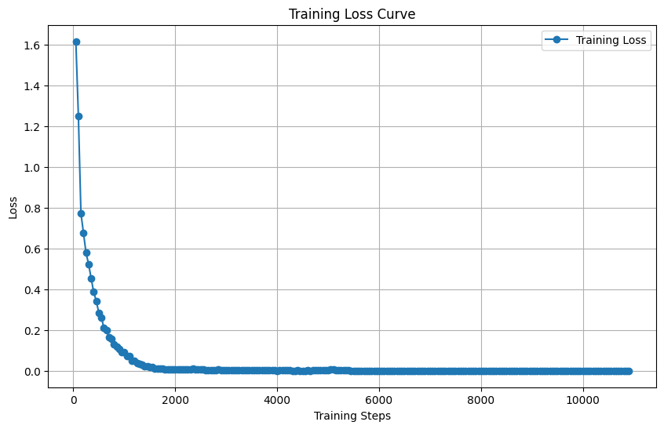

# QueryVerse v0.0.1: Transform Prompts into Data

Natural-language-to-SQL generation by fine-tuning **Llama-3.2-1B-Instruct** on the **Spider** benchmark with **LoRA** and 4-bit quantisation, served through a Gradio interface.

This repository contains the code for the paper:

> **QueryVerse: Transform Prompts into Data**
> Samuji Praneeth, Gundala Pallavi, Dr. R. Prasanna Kumar
> Department of Computer Science and Engineering, Amrita School of Computing, Amrita Vishwa Vidyapeetham, Chennai
> [Paper (PDF)](paper/QueryVerse_paper.pdf)

v0.0.1 is the original B.Tech final-year project, released as published. Its limitations are documented [below](#limitations); **QueryVerse v0.0.2** is a redesign that addresses them.

## Models

| Model | Hugging Face |
|---|---|
| LoRA adapter (from the paper) | [EvaruRaMeeruAntha/QueryVerse_final](https://huggingface.co/EvaruRaMeeruAntha/QueryVerse_final) |
| Merged model (from the paper) | [EvaruRaMeeruAntha/QueryVerse_final_merged](https://huggingface.co/EvaruRaMeeruAntha/QueryVerse_final_merged) |

## Method

| Component | Setting |
|---|---|
| Base model | `unsloth/Llama-3.2-1B-Instruct`, 4-bit quantised (Unsloth) |
| Fine-tuning | LoRA: rank 16, alpha 16, dropout 0, on `q/k/v/o_proj` and `gate/up/down_proj` (11.3M trainable parameters) |
| Data | Spider train split ([`xlangai/spider`](https://huggingface.co/datasets/xlangai/spider)), 7,000 question–SQL pairs in the Llama-3.1 chat format |
| Loss | Assistant (SQL) tokens only |
| Optimisation | AdamW 8-bit, lr 1e-4, cosine with restarts, 1,000 warm-up steps, weight decay 0.02 |
| Batch | 16 per device × 4 gradient accumulation = 64 |
| Training | 100 epochs (10,900 steps), gradient checkpointing, max sequence length 2,048 |
| Interface | Gradio app: schema + question in, SQL out |



*Training loss of the original 100-epoch run: 1.62 at step 50, 0.0018 at step 10,900 (2 h 44 min of training). The full log is in [`original/`](original/QueryVerse_original_btech.ipynb).*

## Results (as reported in the paper)

Text-similarity comparison on the paper's evaluation query:

| Model | ROUGE-1 | ROUGE-2 | ROUGE-L | Cosine sim. |
|---|---|---|---|---|
| SQLNet | 0.10 | 0.05 | 0.08 | 0.12 |
| Seq2SQL | 0.15 | 0.07 | 0.13 | 0.14 |
| RAT-SQL | 0.30 | 0.18 | 0.27 | 0.18 |
| Mistral-7B | 0.25 | 0.00 | 0.1667 | 0.1568 |
| **QueryVerse (fine-tuned)** | **0.5833** | **0.153** | **0.5833** | **0.2022** |

Notes for readers:
- The QueryVerse and Mistral-7B scores come from a single evaluation query (notebook section 12). The SQLNet, Seq2SQL and RAT-SQL rows are not produced by this code.
- The paper's abstract lists a different set of ROUGE values (0.1772 / 0.0345 / 0.1772) than Table I above.
- Section 12 of the notebook reproduces the QueryVerse vs Mistral-7B comparison. Exact values can differ from the paper with library versions.

## Repository contents

```
QueryVerse_v0.0.1.ipynb            cleaned, runnable notebook (training → merge → inference → evaluation → app)
original/QueryVerse_original_btech.ipynb   original project notebook with its outputs (tokens redacted)
assets/training_loss_original.png  loss curve of the original training run
paper/QueryVerse_paper.pdf         the paper
```

The cleaned notebook keeps the method identical and only fixes what prevented it from running end to end. Those fixes are listed in its first cell: tokens moved to Colab secrets, automatic fp16/bf16, checkpoint/resume, consistent chat-format inference, and a runnable evaluation cell.

## How to run

1. Open `QueryVerse_v0.0.1.ipynb` in [Google Colab](https://colab.research.google.com) and choose a GPU runtime.
2. In the configuration cell:
   - `RUN_MODE = "quick"` (default) runs the whole pipeline in about 25 minutes on a T4. It trains for 60 steps, then uses the published model for inference, evaluation and the app.
   - `RUN_MODE = "full"` reproduces the paper's 100-epoch training (A100 recommended).
3. Runtime → Run all. The last cell launches the Gradio app with a public link.

To publish a retrained model, add a Hugging Face write token as the Colab secret `HF_TOKEN` and set `PUSH_TO_HUB = True`.

## Limitations

Studying this version led to the redesign in v0.0.2.

1. **No schema conditioning.** Training examples contain only the question and the SQL, not the database schema. The model learns Spider's table and column names rather than how to read a schema, which limits generalisation to new databases, especially for multi-table joins. The paper notes this too.
2. **Over-training without validation.** Training ran for 100 epochs with no validation split. The loss curve flattens near zero after roughly 2,000 steps (about 18 epochs), which points to memorisation of the training set rather than further learning.
3. **Train/inference mismatch in the original app.** The original Gradio app sent a raw-text prompt with a schema, which differs from the chat format used in training. The cleaned notebook uses the training format, but limitation 1 remains.
4. **Evaluation metric.** ROUGE and cosine similarity measure text overlap, not whether a query is correct. Two different queries can return the same result, and two very similar ones can return different results. The standard text-to-SQL metrics are **execution accuracy** and **exact match** on the full Spider dev set (1,034 questions over unseen databases).
5. **Single-example evaluation.** The reported scores come from one query, so they have no statistical weight.
6. **Baselines.** Mistral-7B is the only baseline evaluated in code. A zero-shot Llama-3.2-1B baseline would isolate the effect of fine-tuning.
7. **SQL is generated, not executed.** The app shows SQL text. It does not run it against a database, check that it is valid or safe, or recover from errors.

## Roadmap: QueryVerse v0.0.2

- Schema-conditioned training and inference (tables, keys and sample values in the prompt), using the official Spider release with its SQLite databases
- Validation split, early stopping and best-checkpoint selection
- Execution accuracy and exact match on Spider dev, with a zero-shot baseline and a breakdown by query type
- Safe execution engine: read-only guardrails, time limits, and execution-guided retry when a query fails
- A working product: web app connected to real databases (SQLite, PostgreSQL, MySQL), REST API, tests and CI

## Citation

```bibtex
@inproceedings{praneeth_queryverse,
  title  = {QueryVerse: Transform Prompts into Data},
  author = {Samuji Praneeth and Gundala Pallavi and R. Prasanna Kumar},
  note   = {<2025>}
}
```

## License

MIT
